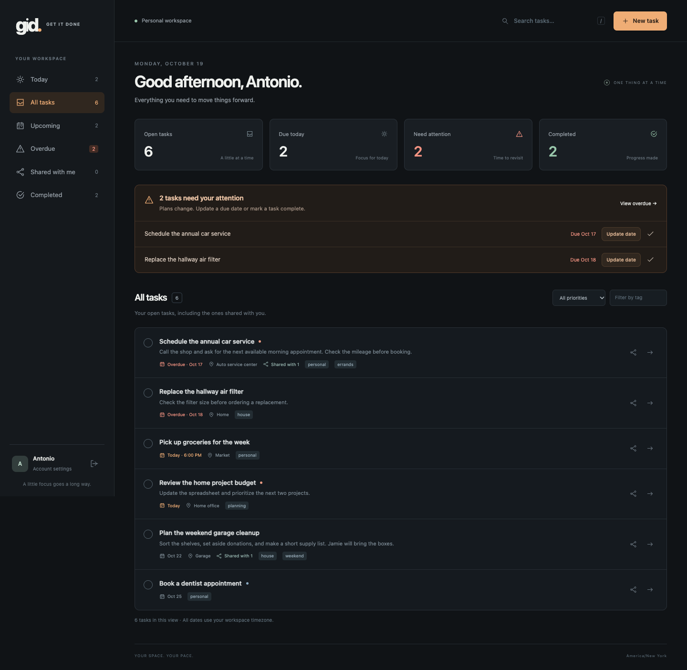

# GID — Get It Done

A small, self-hosted place for the things you need to get done. GID runs in one Docker container, stores its data in SQLite, and has a responsive dark interface for desktop and phone browsers.

- Create tasks with notes, a location, a due date and optional time, priority, and tags. Created, updated, and completed dates are recorded automatically.
- Focus on Today, Upcoming, Overdue, or tasks shared with you. Search and filter your lists.
- Share a task with another user with **view** or **edit** permission. Owners control sharing; editors can update and complete tasks.
- Complete a task to remove it from the active list. Find it in **Completed**, reopen it, or export authorized tasks to CSV for reporting.
- Administrators create and manage accounts and set the application name and timezone. Administrators see tasks through the same ownership and sharing rules as everyone else.

Version 0.1.1 provides reminders inside the dashboard. Email, push notifications, and recurring tasks are not included.

<details>
<summary>Dashboard preview with sample tasks</summary>



[See the mobile layout](docs/mobile.png).

</details>

## Install on Ubuntu 24.04

On your Ubuntu Docker host, install the prerequisites:

```sh
sudo apt update
sudo apt install -y git docker.io docker-compose-v2 docker-buildx
sudo systemctl enable --now docker
```

Clone the public repository, build the image, and start GID:

```sh
cd ~
git clone https://github.com/DasFunfZigste/GID.git
cd GID
sudo docker compose up -d --build --wait
```

Open **`http://YOUR_SERVER_IP:8001`**. GID uses port 8001 so it can run beside GDeploy's default port 8000. No initial `.env` file is required.

No GitHub account, access token, or Docker registry login is required to install or update GID.

On the first sign-in, use **`admin` / `admin`**. GID immediately requires you to replace the default password with one of at least **12 characters** before you can access tasks or administration. Enter `admin` as the current password and save your new password in your password manager.

Use **Administration → People** to create other accounts. Users sign in with their own credentials and can share tasks with another active user. Public registration is disabled. Open **Administration → Settings** to change the application name or timezone; the initial timezone is **America/New_York**.

The default address listens on the Docker host's network interfaces for LAN access. To change the host port, place `GID_PORT=8002` in a `.env` file beside `compose.yaml`, then run the Compose command again. `GID_BIND_IP` selects the host address; for example, `127.0.0.1` limits access to the host itself.

## Update

Use the same clone and Docker volume:

```sh
cd ~/GID
git pull --ff-only
sudo docker compose up -d --build --wait
```

Refresh your browser after the rebuild. If you are upgrading from the earlier setup-code screen and have not created an account, the same volume automatically receives **`admin` / `admin`**; sign in and change the password. Existing configured accounts keep their current passwords.

Accounts, tasks, shares, settings, and completion history remain in the `gid_gid-data` Docker volume mounted at `/data`. Keep the volume when rebuilding or replacing the container. **`docker compose down -v` erases this saved data.**

To check operation:

```sh
sudo docker compose ps
sudo docker compose logs --tail=100 gid
```

## Back up and restore

Run these commands from the `GID` directory. Back up before updating. The archive contains private notes and account data; keep it somewhere you control and copy it off the Docker host.

Stop the app for a consistent backup, archive the complete data volume, then start it again:

```sh
(
  set -e
  umask 077
  mkdir -p backups
  GID_BACKUP_FILE="backups/gid-$(date +%Y%m%d-%H%M%S).tar.gz"
  sudo docker compose stop gid
  trap 'sudo docker compose start --wait gid' EXIT
  sudo docker compose run --rm --no-deps -T --entrypoint tar gid --numeric-owner -C /data -czpf - . > "$GID_BACKUP_FILE"
  tar -tzf "$GID_BACKUP_FILE" > /dev/null
)
```

Check that the archive command succeeded before moving or relying on the file. The archive preserves file permissions and ownership metadata. The app and restore commands run as UID/GID `10001:10001`, so restored files have the ownership the container needs.

**Restore replaces all current GID data.** Make a backup first. Select your archive, stop the app, clear the data directory, extract the archive, and start GID:

```sh
(
  set -e
  GID_BACKUP_FILE="backups/gid-YYYYMMDD-HHMMSS.tar.gz"
  test -s "$GID_BACKUP_FILE"
  tar -tzf "$GID_BACKUP_FILE" > /dev/null
  sudo docker compose stop gid
  sudo docker compose run --rm --no-deps -T --entrypoint sh gid -c 'find /data -mindepth 1 -maxdepth 1 -exec rm -rf -- {} + && tar --no-same-owner -C /data -xzpf -' < "$GID_BACKUP_FILE"
  sudo docker compose start --wait gid
)
```

The restore command checks the archive before clearing current data and leaves the app stopped if extraction fails. For a fresh host, clone the repository and build it with `sudo docker compose build` before running the restore commands.

## Development

Python 3.12 or later is required. No Node.js runtime or frontend build is needed.

```sh
python3.12 -m venv .venv
. .venv/bin/activate
pip install -r requirements-dev.txt
pytest -q
GID_DATA_DIR=./data uvicorn gid.main:app --host 127.0.0.1 --port 8001 --reload
```

The application uses FastAPI, the Python standard library's SQLite and scrypt, and HTML/CSS/JavaScript served from the same origin. Docker runs one worker with a persistent data volume, a non-root user, a read-only root filesystem, and dropped Linux capabilities. Run one application instance per database. GitHub Actions runs the tests and builds and smoke-tests the container, including the required first password change and persistence across restart.
